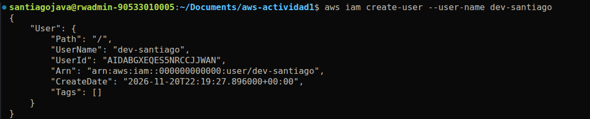
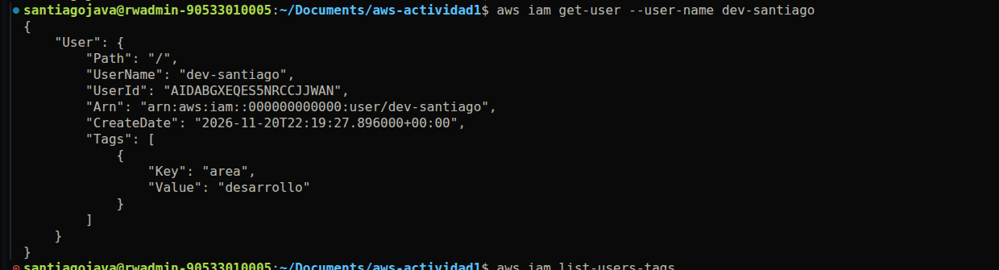
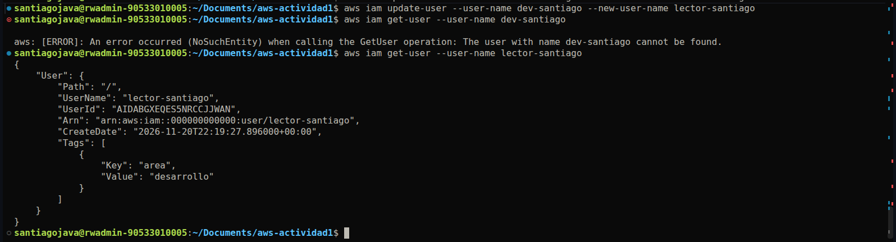
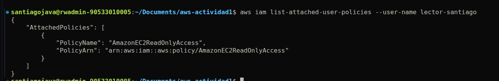
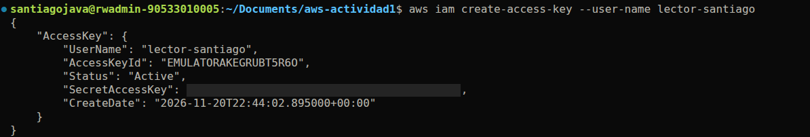
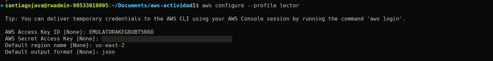
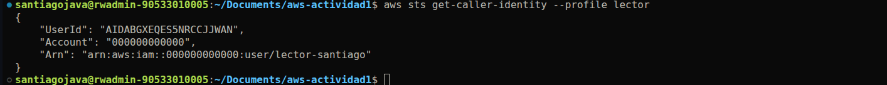
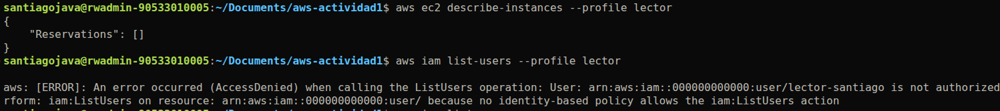
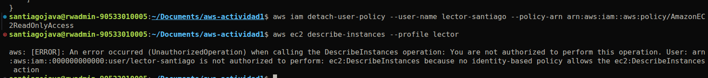
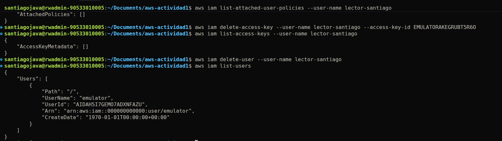

# Ciclo de vida de un usuario IAM

**Objetivo.** Crear, consultar, editar, probar y eliminar un usuario IAM desde la AWS CLI y comprobar el principio de menor privilegio.

La práctica sigue al usuario `dev-santiago`, renombrado como `lector-santiago`.

> La clave secreta se ocultó en las transcripciones y en las dos capturas donde aparecía.

## Parte 1. Crear el usuario

### Creación y registro del ARN (pasos 1 y 3)

```text
aws iam create-user --user-name dev-santiago
{
"User": {
"Path": "/",
"UserName": "dev-santiago",
"UserId": "AIDABGXEQES5NRCCJJWAN",
"Arn": "arn:aws:iam::000000000000:user/dev-santiago",
"CreateDate": "2026-11-20T22:19:27.896000+00:00",
"Tags": []
}
}
```



La respuesta de creación ya muestra el ARN inicial: `arn:aws:iam::000000000000:user/dev-santiago`. La consulta del usuario se documenta en la parte 2.

## Parte 2. Editar el usuario

### Consulta de la etiqueta (paso 4)

```text
santiagojava@rwadmin-90533010005:~/Documents/aws-actividad1$ aws iam get-user --user-name dev-santiago
{
"User": {
"Path": "/",
"UserName": "dev-santiago",
"UserId": "AIDABGXEQES5NRCCJJWAN",
"Arn": "arn:aws:iam::000000000000:user/dev-santiago",
"CreateDate": "2026-11-20T22:19:27.896000+00:00",
"Tags": [
{
"Key": "area",
"Value": "desarrollo"
}
]
}
}
```



### Cambio de nombre y verificación (pasos 5 y 6)

```text
santiagojava@rwadmin-90533010005:~/Documents/aws-actividad1$ aws iam update-user --user-name dev-santiago --new-user-name lector-santiago
santiagojava@rwadmin-90533010005:~/Documents/aws-actividad1$ aws iam get-user --user-name dev-santiago

aws: [ERROR]: An error occurred (NoSuchEntity) when calling the GetUser operation: The user with name dev-santiago cannot be found.
santiagojava@rwadmin-90533010005:~/Documents/aws-actividad1$ aws iam get-user --user-name lector-santiago
{
"User": {
"Path": "/",
"UserName": "lector-santiago",
"UserId": "AIDABGXEQES5NRCCJJWAN",
"Arn": "arn:aws:iam::000000000000:user/lector-santiago",
"CreateDate": "2026-11-20T22:19:27.896000+00:00",
"Tags": [
{
"Key": "area",
"Value": "desarrollo"
}
]
}
}
```



## Parte 3. Dar permisos

### Adjuntar y comprobar la política de lectura de EC2 (pasos 7 y 8)

```bash
aws iam attach-user-policy --user-name lector-santiago --policy-arn arn:aws:iam::aws:policy/AmazonEC2ReadOnlyAccess
```

```text
santiagojava@rwadmin-90533010005:~/Documents/aws-actividad1$ aws iam list-attached-user-policies --user-name lector-santiago
{
"AttachedPolicies": [
{
"PolicyName": "AmazonEC2ReadOnlyAccess",
"PolicyArn": "arn:aws:iam::aws:policy/AmazonEC2ReadOnlyAccess"
}
]
}
```



## Parte 4. Probar el menor privilegio

### Crear la llave de acceso (paso 9)

```text
santiagojava@rwadmin-90533010005:~/Documents/aws-actividad1$ aws iam create-access-key --user-name lector-santiago
{
"AccessKey": {
"UserName": "lector-santiago",
"AccessKeyId": "EMULATORAKEGRUBT5R6O",
"Status": "Active",
"SecretAccessKey": "[CLAVE SECRETA OCULTA]",
"CreateDate": "2026-11-20T22:44:02.895000+00:00"
}
}
santiagojava@rwadmin-90533010005:~/Documents/aws-actividad1$ aws iam create-access-key --user-name lector-santiago
{
"AccessKey": {
"UserName": "lector-santiago",
"AccessKeyId": "EMULATORAKEGRUBT5R6O",
"Status": "Active",
"SecretAccessKey": "[CLAVE SECRETA OCULTA]",
"CreateDate": "2026-11-20T22:44:02.895000+00:00"
}
}
```



### Configurar el perfil lector (paso 10)

```text
santiagojava@rwadmin-90533010005:~/Documents/aws-actividad1$ aws configure --profile lector

Tip: You can deliver temporary credentials to the AWS CLI using your AWS Console session by running the command 'aws login'.

AWS Access Key ID [None]: EMULATORAKEGRUBT5R6O
AWS Secret Access Key [None]: [CLAVE SECRETA OCULTA]
Default region name [None]: us-east-2
Default output format [None]: json
```



### Comprobar la identidad (paso 11)

```text
santiagojava@rwadmin-90533010005:~/Documents/aws-actividad1$ aws sts get-caller-identity --profile lector
{
"UserId": "AIDABGXEQES5NRCCJJWAN",
"Account": "000000000000",
"Arn": "arn:aws:iam::000000000000:user/lector-santiago"
}
```



### Comparar la acción permitida y la denegada (pasos 12 y 13)

```text
santiagojava@rwadmin-90533010005:~/Documents/aws-actividad1$ aws ec2 describe-instances --profile lector
{
"Reservations": []
}
santiagojava@rwadmin-90533010005:~/Documents/aws-actividad1$ aws iam list-users --profile lector

aws: [ERROR]: An error occurred (AccessDenied) when calling the ListUsers operation: User: arn:aws:iam::000000000000:user/lector-santiago is not authorized to perform: iam:ListUsers on resource: arn:aws:iam::000000000000:user/ because no identity-based policy allows the iam:ListUsers action
```



## Parte 5. Quitar permisos

### Retirar la política y repetir la consulta de EC2 (pasos 14 y 15)

```text
santiagojava@rwadmin-90533010005:~/Documents/aws-actividad1$ aws iam list-attached-user-policies --user-name lector-santiago
{
"AttachedPolicies": [
{
"PolicyName": "AmazonEC2ReadOnlyAccess",
"PolicyArn": "arn:aws:iam::aws:policy/AmazonEC2ReadOnlyAccess"
}
]
}
santiagojava@rwadmin-90533010005:~/Documents/aws-actividad1$ aws iam detach-user-policy --user-name lector-santiago --policy-arn arn:aws:iam::aws:policy/AmazonEC2ReadOnlyAccess
santiagojava@rwadmin-90533010005:~/Documents/aws-actividad1$ aws ec2 describe-instances --profile lector

aws: [ERROR]: An error occurred (UnauthorizedOperation) when calling the DescribeInstances operation: You are not authorized to perform this operation. User: arn:aws:iam::000000000000:user/lector-santiago is not authorized to perform: ec2:DescribeInstances because no identity-based policy allows the ec2:DescribeInstances action
```



## Parte 6. Eliminar el usuario

### Consultar y eliminar la llave, verificar las políticas y eliminar el usuario (pasos 16 a 19)

```text
santiagojava@rwadmin-90533010005:~/Documents/aws-actividad1$ aws iam list-access-keys --user-name lector-santiago
{
"AccessKeyMetadata": [
{
"UserName": "lector-santiago",
"AccessKeyId": "EMULATORAKEGRUBT5R6O",
"Status": "Active",
"CreateDate": "2026-11-20T22:44:02.895000+00:00"
}
]
}
santiagojava@rwadmin-90533010005:~/Documents/aws-actividad1$ aws iam list-attached-user-policies --user-name lector-santiago
{
"AttachedPolicies": []
}
santiagojava@rwadmin-90533010005:~/Documents/aws-actividad1$ aws iam delete-access-key --user-name lector-santiago --access-key-id EMULATORAKEGRUBT5R6O
santiagojava@rwadmin-90533010005:~/Documents/aws-actividad1$ aws iam list-access-keys --user-name lector-santiago
{
"AccessKeyMetadata": []
}
santiagojava@rwadmin-90533010005:~/Documents/aws-actividad1$ aws iam delete-user --user-name lector-santiago
santiagojava@rwadmin-90533010005:~/Documents/aws-actividad1$ aws iam list-users
{
"Users": [
{
"Path": "/",
"UserName": "emulator",
"UserId": "AIDAH5I7GEMO7ADXNFAZU",
"Arn": "arn:aws:iam::000000000000:user/emulator",
"CreateDate": "1970-01-01T00:00:00+00:00"
}
]
}
```


