# Servidor web en EC2 con un rol de IAM

La práctica se hizo en `us-east-2`. Lancé una instancia Amazon Linux 2023 con Apache, comprobé desde la instancia qué podía hacer el rol `ec2-lector-s3` y observé el cambio de IP pública al detenerla y volverla a iniciar.

## Parte 1. Reconocer el terreno

### Identidad y región (paso 1)

```text
$ aws sts get-caller-identity --query "Arn"
"arn:aws:iam::221829235055:user/admin-santiago"
$ aws configure get region
us-east-2
```

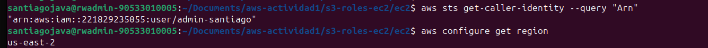

### Perfil de instancia (paso 2)

El perfil y el rol asociado se llamaban `ec2-lector-s3`.

```text
$ aws iam get-instance-profile --instance-profile-name ec2-lector-s3 --query "InstanceProfile.[InstanceProfileName, Roles[0].RoleName]"
[
    "ec2-lector-s3",
    "ec2-lector-s3"
]
```

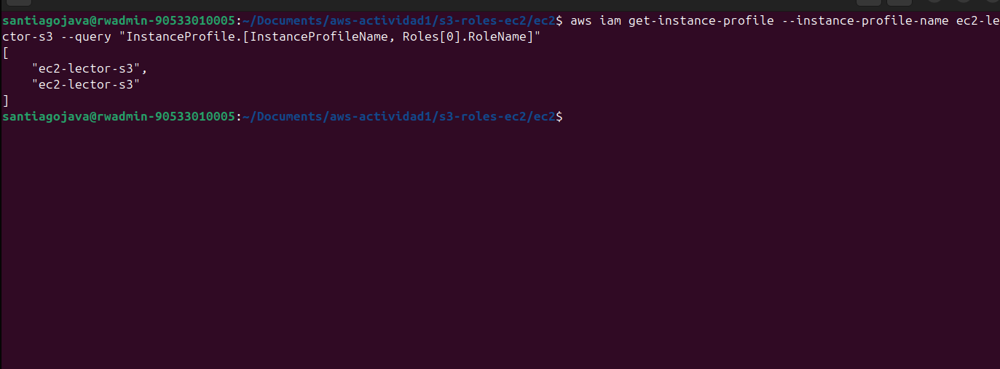

### AMI y VPC por defecto (pasos 3 y 4)

```text
$ AMI_ID=$(aws ssm get-parameters --names /aws/service/ami-amazon-linux-latest/al2023-ami-kernel-default-x86_64 --query "Parameters[0].Value" --output text)
$ echo $AMI_ID
ami-01e4a7224fcbfe81f
```

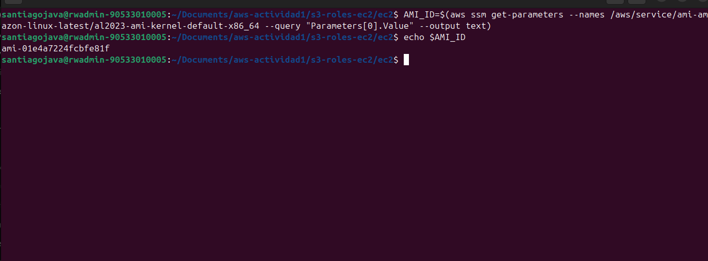

```text
$ VPC_ID=$(aws ec2 describe-vpcs --filter Name=isDefault=true --query "Vpcs[].VpcId" --output text)
$ echo $VPC_ID
vpc-0f745e257dfc7d2f6
```

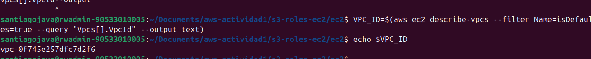

## Parte 2. Par de llaves (pasos 5 a 7)

Creé el par `santiago`, guardé la llave privada en `santiago-private.pem` y ejecuté `chmod 400` sobre el archivo.

```bash
aws ec2 create-key-pair --key-name santiago --query "KeyMaterial" --output text > santiago-private.pem
chmod 400 santiago-private.pem
```

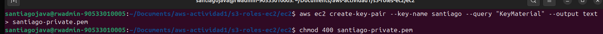

```text
$ aws ec2 describe-key-pairs --query "KeyPairs[].KeyName" --output table
------------------
|DescribeKeyPairs|
+----------------+
|  santiago      |
+----------------+
```

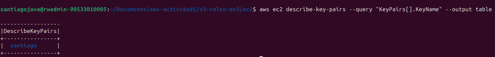

## Parte 3. Security group (pasos 8 a 12)

Creé el grupo `web-santiago` y guardé su identificador en `SG_ID`.

```text
$ aws ec2 create-security-group --group-name web-santiago --description "HTTP abierto y SSH solo desde mi IP" --query "GroupId" --output text
sg-01b239d5acf80f251
$ SG_ID=sg-01b239d5acf80f251
$ echo $SG_ID
sg-01b239d5acf80f251
```

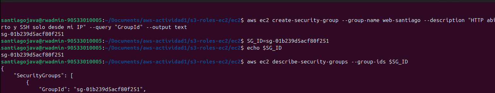

Consulté mi IP de origen para usarla en la regla de SSH.

```text
$ MY_IP=$(curl https://checkip.amazonaws.com)
$ echo $MY_IP
190.71.177.60
```

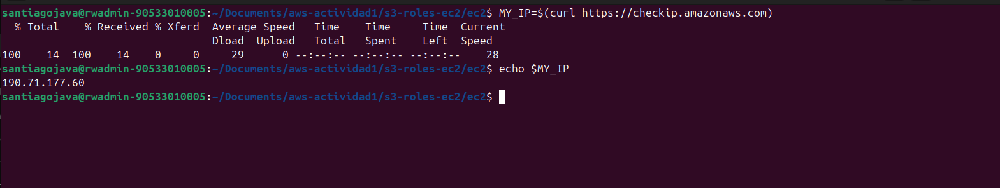

Autoricé HTTP desde `0.0.0.0/0` y SSH desde `190.71.177.60/32`. En ambos casos la CLI devolvió `"Return": true`.

```bash
aws ec2 authorize-security-group-ingress --group-id $SG_ID --protocol tcp --port 80 --cidr 0.0.0.0/0
```

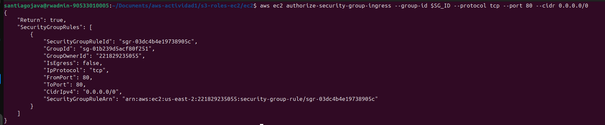

```bash
aws ec2 authorize-security-group-ingress --group-id $SG_ID --protocol tcp --port 22 --cidr $MY_IP/32
```

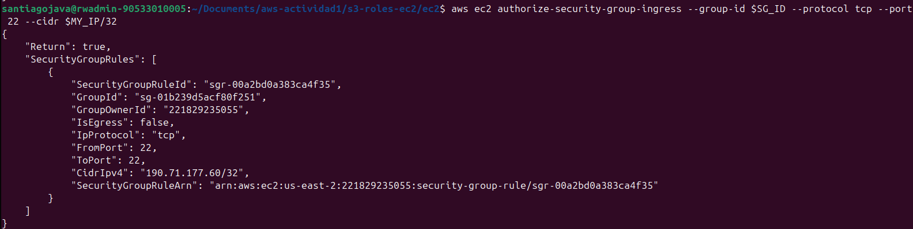

```bash
aws ec2 describe-security-groups --group-ids $SG_ID
```

La captura de la consulta muestra el grupo, su VPC, la regla de salida y el inicio de la regla de entrada del puerto 80. Las dos capturas anteriores muestran los puertos y CIDR completos de cada regla de entrada.

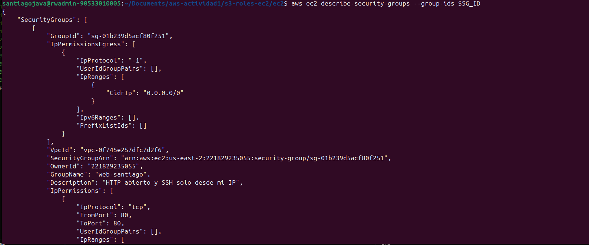

## Parte 4. Lanzar la instancia (pasos 13 a 16)

El script [inicio.sh](scripts/inicio.sh) instala Apache, lo activa y escribe la página de inicio.

```bash
#!/bin/bash
dnf install -y httpd
systemctl enable --now httpd
echo "<h1>Hola desde mi instancia EC2</h1>" > /var/www/html/index.html
```

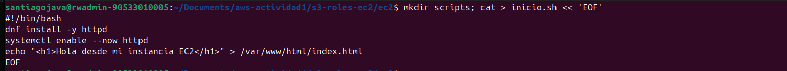

Lancé una `t3.micro` con el perfil `ec2-lector-s3`. El comando de la captura conserva el valor `<nombre-instancia>` en la etiqueta `Name`. La consulta siguiente muestra la IP pública inicial. La espera del paso 15 quedó fuera de la captura.

```text
$ aws ec2 run-instances --image-id $AMI_ID --instance-type t3.micro --key-name santiago --security-group-ids $SG_ID --iam-instance-profile Name=ec2-lector-s3 --user-data file://scripts/inicio.sh --tag-specifications "ResourceType=instance,Tags=[{Key=Name,Value=<nombre-instancia>}]" --query "Instances[0].InstanceId" --output text
i-0037f96229e7e26e0
$ aws ec2 describe-instances --instance-ids i-0037f96229e7e26e0 --query "Reservations[0].Instances[0].PublicIpAddress" --output text
3.143.170.238
```

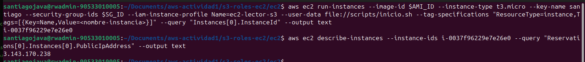

## Parte 5. Probar el servidor web (pasos 17 y 18)

La prueba HTTP disponible fue desde la propia instancia. Apache devolvió el encabezado escrito por `inicio.sh`.

```text
[ec2-user@ip-172-31-20-160 ~]$ curl localhost
<h1>Hola desde mi instancia EC2</h1>
```

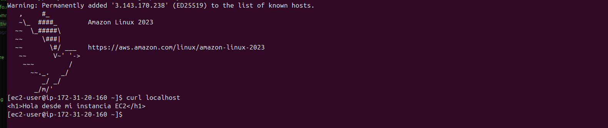

Quedó pendiente la evidencia de acceso a la IP pública desde el navegador y desde una terminal externa. El encabezado que devuelve Apache dice `Hola desde mi instancia EC2`.

## Parte 6. Entrar y probar el rol (pasos 19 a 24)

### Acceso e identidad de la instancia (pasos 19 y 20)

La captura de [`curl localhost`](imgs/6.png) también muestra el acceso por SSH, el inicio de sesión de Amazon Linux 2023 y el prompt de `ec2-user`.

```text
Warning: Permanently added '3.143.170.238' (ED25519) to the list of known hosts.
[ec2-user@ip-172-31-20-160 ~]$
```

La salida de `aws sts get-caller-identity` dentro de EC2 quedó sin captura. El ARN visible en los dos errores del final de esta parte identifica la sesión del rol asumido.

```text
arn:aws:sts::221829235055:assumed-role/ec2-lector-s3/i-0037f96229e7e26e0
```

### Lectura del objeto (paso 21)

```text
[ec2-user@ip-172-31-20-160 ~]$ aws s3 cp s3://reportes-santiago-001/reporte.txt -
reporte
```

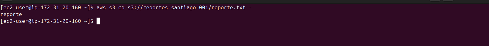

### Operaciones denegadas (pasos 22 y 23)

El primer error visible corresponde a `ListBuckets`, la operación que lista los buckets de la cuenta. Quedó sin evidencia el intento de listar los objetos de `reportes-santiago-001`, que requiere `s3:ListBucket`. El segundo error corresponde a `aws iam list-users`.

Estos fragmentos de la terminal muestran la operación y el permiso faltante.

```text
aws: [ERROR]: An error occurred (AccessDenied) when calling the ListBuckets operation: User: arn:aws:sts::221829235055:assumed-role/ec2-lector-s3/i-0037f96229e7e26e0 is not authorized to perform: s3:ListAllMyBuckets because no identity-based policy allows the s3:ListAllMyBuckets action
[ec2-user@ip-172-31-20-160 ~]$ aws iam list-users
aws: [ERROR]: An error occurred (AccessDenied) when calling the ListUsers operation: User: arn:aws:sts::221829235055:assumed-role/ec2-lector-s3/i-0037f96229e7e26e0 is not authorized to perform: iam:ListUsers on resource: arn:aws:iam::221829235055:user/ because no identity-based policy allows the iam:ListUsers action.
```

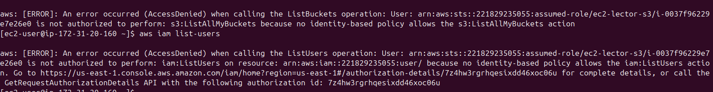

El cierre de la sesión con `exit` quedó fuera de las capturas.

## Parte 7. Estados de la instancia (pasos 25 a 27)

La primera orden de apagado mostró el paso de `running` a `stopping`. El listado la mostró en `stopped` y con `None` en la columna de IP pública.

```text
$ aws ec2 stop-instances --instance-ids i-0037f96229e7e26e0
$ aws ec2 describe-instances --filters "Name=instance-state-name,Values=pending,running,stopping,stopped,shutting-down" --query "Reservations[].Instances[].[InstanceId,State.Name,InstanceType,PublicIpAddress]" --output table
|  i-0037f96229e7e26e0  |  stopped  |  t3.micro  |  None  |
```

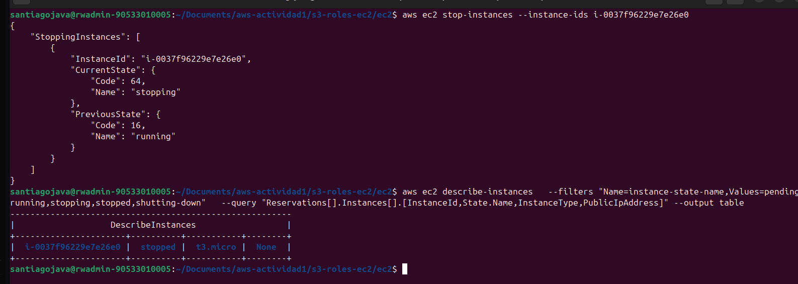

La captura siguiente empieza con la espera de `running`. Al consultar la IP pública, el resultado cambió de `3.143.170.238` a `18.216.245.117`.

```text
$ aws ec2 wait instance-running --instance-ids i-0037f96229e7e26e0
$ aws ec2 describe-instances --instance-ids i-0037f96229e7e26e0 --query "Reservations[0].Instances[0].PublicIpAddress" --output text
18.216.245.117
```

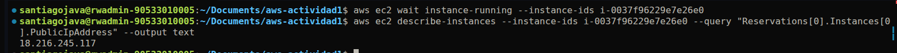

Volví a solicitar el apagado antes de la limpieza. El estado visible en ese momento fue `stopping`.

```text
$ aws ec2 stop-instances --instance-ids i-0037f96229e7e26e0
```

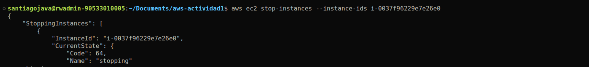

## Parte 8. Eliminar (pasos 28 a 32)

### Instancia y security group (pasos 28 y 29)

La respuesta de terminación muestra `stopped` como estado previo y `terminated` como estado actual.

```text
PS> aws ec2 terminate-instances --instance-ids i-0037f96229e7e26e0
{
    "TerminatingInstances": [
        {
            "InstanceId": "i-0037f96229e7e26e0",
            "CurrentState": {
                "Code": 48,
                "Name": "terminated"
            },
            "PreviousState": {
                "Code": 80,
                "Name": "stopped"
            }
        }
    ]
}
```

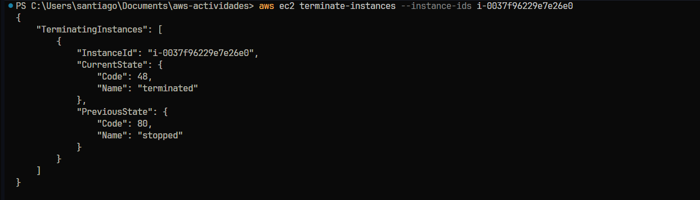

```text
PS> aws ec2 delete-security-group --group-id sg-01b239d5acf80f251
{
    "Return": true,
    "GroupId": "sg-01b239d5acf80f251"
}
```

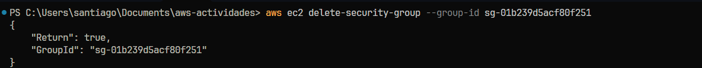

### Par de llaves y consulta final (pasos 30 y 31)

```text
PS> aws ec2 delete-key-pair --key-name santiago
{
    "Return": true,
    "KeyPairId": "key-021f98fdf3ff7cc36"
}
```

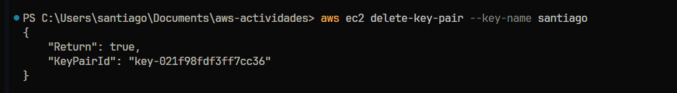

La captura confirma la eliminación del par en AWS. El borrado del archivo `.pem` local quedó sin documentar.

```text
PS> aws ec2 describe-instances --query "Reservations[0].Instances[0].State.Name" --output text
terminated
```

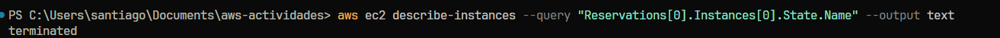

La consulta del paso 31 solo devuelve el estado de la primera instancia de la primera reserva. Quedó pendiente un listado que verifique todos los estados `running` y `stopped` de la región.

### Bucket, perfil, política y rol (paso 32)

```text
PS> aws s3 rb s3://reportes-santiago-001 --force
delete: s3://reportes-santiago-001/reporte.txt
remove_bucket: reportes-santiago-001
```

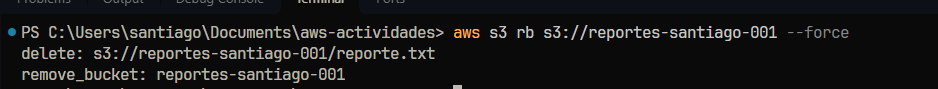

Consulté el perfil asociado y la política en línea `leer-reportes`. Después ejecuté los comandos para separar el rol del perfil y borrar el perfil, la política y el rol. La captura vuelve al prompt sin mostrar errores ni una consulta posterior de verificación.

```powershell
aws iam list-instance-profiles-for-role --role-name ec2-lector-s3
aws iam list-role-policies --role-name ec2-lector-s3
aws iam remove-role-from-instance-profile --instance-profile-name ec2-lector-s3 --role-name ec2-lector-s3
aws iam delete-instance-profile --instance-profile-name ec2-lector-s3
aws iam delete-role-policy --role-name ec2-lector-s3 --policy-name leer-reportes
aws iam delete-role --role-name ec2-lector-s3
```

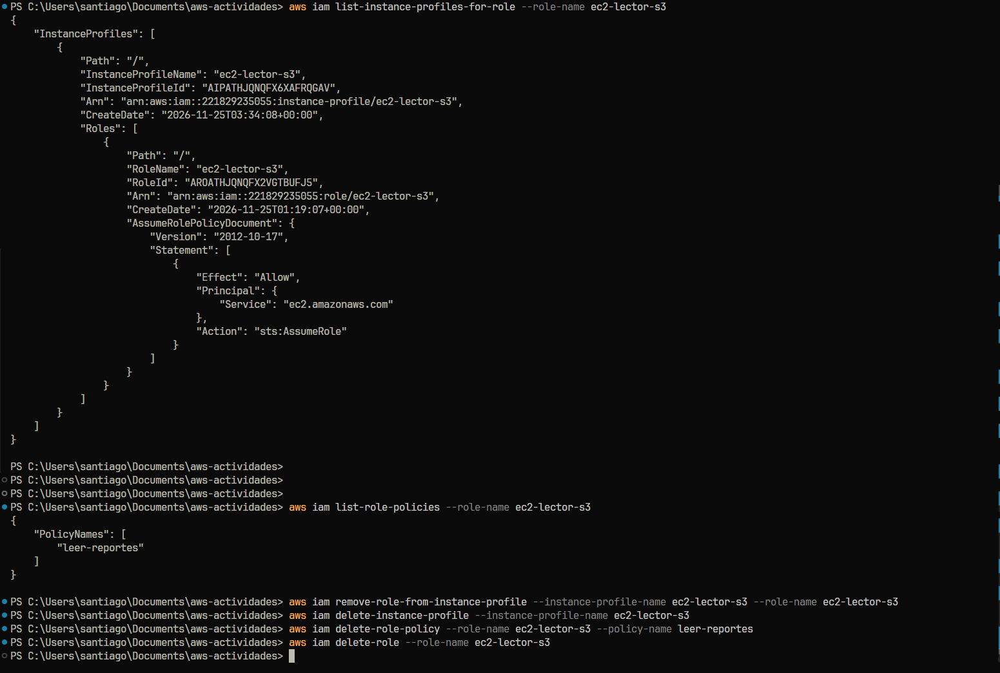

El intento del reto quedó sin captura.

## Preguntas de reflexión

1. **¿De dónde salieron las credenciales de la instancia?** Al lanzar la instancia le asocié el perfil `ec2-lector-s3`. La política de confianza permite que EC2 asuma ese rol. AWS entrega credenciales temporales mediante el servicio de metadatos de la instancia y la CLI puede tomarlas de ahí automáticamente, sin `aws configure`. El ARN de los errores muestra que las peticiones se hicieron con una sesión del rol asociada a esa instancia.
2. **¿Por qué abrir el puerto 80 y restringir el 22?** El puerto 80 sirve la página que quiero que los visitantes puedan abrir. El 22 da acceso administrativo al servidor por SSH. Con `190.71.177.60/32` limito quién puede iniciar esa conexión y reduzco los intentos de acceso desde internet.
3. **¿Dónde se decidió qué podía leer el rol?** En su política de permisos en línea, `leer-reportes`. Leer `reporte.txt` requiere `s3:GetObject` sobre el objeto. Listar el contenido del bucket requiere un permiso distinto, `s3:ListBucket`, sobre el bucket. El error capturado fue de `s3:ListAllMyBuckets`, que corresponde a listar los buckets de la cuenta.
4. **¿Por qué cambió la IP pública al detener e iniciar la instancia?** La IP pública asignada automáticamente se libera al detener la instancia y EC2 puede asignarle otra al arrancar. Pasó de `3.143.170.238` a `18.216.245.117`. Si el DNS del sitio siguiera apuntando a la IP anterior, los visitantes dejarían de llegar al servidor hasta actualizar el registro. Una Elastic IP mantendría una dirección fija.
5. **¿Qué fue responsabilidad mía y qué fue responsabilidad de AWS?** Yo elegí la AMI y el tipo de instancia, configuré el grupo de seguridad y el rol, instalé y administré Apache y publiqué la página. También me correspondía mantener el sistema invitado y terminar los recursos al acabar. AWS se encargó de la infraestructura física, la red subyacente y la capa de virtualización.
6. **¿Qué habría necesitado para montar el servidor en una oficina?** Un equipo con almacenamiento, conectividad a internet con una IP pública accesible, un router y un firewall. Tendría que instalar Linux y Apache, publicar la página, configurar las reglas de red y el DNS, y encargarme de las actualizaciones, las copias de seguridad y la disponibilidad del equipo.
