# Rol de IAM para una instancia EC2

La práctica prepara el rol `ec2-lector-s3` y un perfil de instancia del mismo nombre para que EC2 pueda leer objetos del bucket `reportes-santiago-001`.

## 1. Bucket y archivo de prueba (pasos 1 a 3)

`aws s3 cp` muestra la subida de `files/reporte.txt` a `s3://reportes-santiago-001/reporte.txt`. El comando `aws s3 ls` muestra `reportes-santiago-001` en el listado de buckets. Quedó sin captura el listado de objetos del bucket.

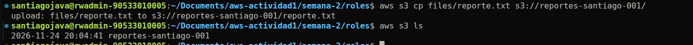

## 2. Políticas de confianza y de permisos (pasos 4 a 6)

### Política de confianza

El archivo permite que el servicio EC2 asuma el rol mediante `sts:AssumeRole`. [confianza.json](./files/policies/confianza.json)

```json
{
  "Version": "2012-10-17",
  "Statement": [
    {
      "Effect": "Allow",
      "Principal": {
        "Service": "ec2.amazonaws.com"
      },
      "Action": "sts:AssumeRole"
    }
  ]
}
```

### Política de permisos

El archivo permite `s3:GetObject` sobre los objetos de `reportes-santiago-001`. [permisos.json](./files/policies/permisos.json)

```json
{
  "Version": "2012-10-17",
  "Statement": [
    {
      "Effect": "Allow",
      "Action": ["s3:GetObject"],
      "Resource": ["arn:aws:s3:::reportes-santiago-001/*"]
    }
  ]
}
```

Los dos archivos del repositorio se validaron como JSON al preparar la entrega. La captura del editor muestra una versión anterior con `service` en minúscula. La consulta del rol en el paso 9 confirma que la política aplicada usa `Service`.

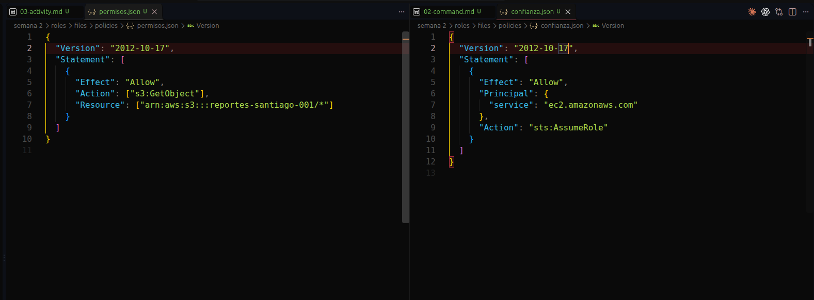

## 3. Creación y consulta del rol (pasos 7 a 10)

- **Paso 7.** Falta una captura o salida legible del intento de crear el rol sin `--assume-role-policy-document`.
- **Pasos 8 y 9.** `create-role` con `file://files/policies/confianza.json` devuelve el rol `ec2-lector-s3`. `get-role` confirma el ARN `arn:aws:iam::221829235055:role/ec2-lector-s3` y la política de confianza para `ec2.amazonaws.com`.
- **Paso 10.** El listado de políticas en línea disponible se tomó después de agregar `leer-reportes`. El listado inicial quedó sin evidencia.

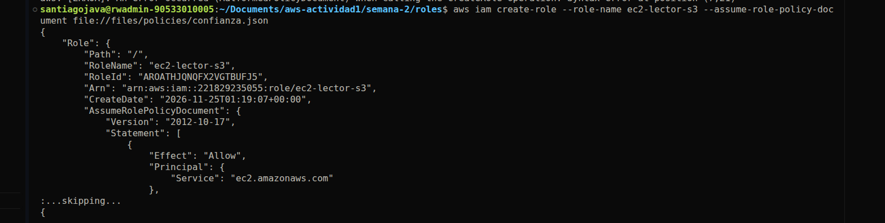

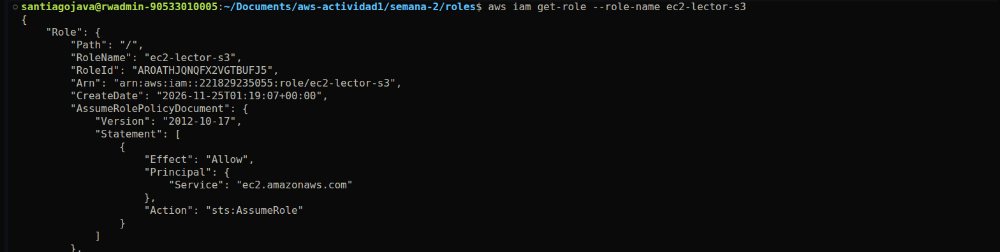

## 4. Política en línea `leer-reportes` (pasos 11 a 13)

Después de ejecutar `put-role-policy` con `permisos.json`, `list-role-policies` devuelve `leer-reportes`. En el paso 13, `get-role-policy` muestra que la única acción permitida es `s3:GetObject`, con alcance `arn:aws:s3:::reportes-santiago-001/*`.

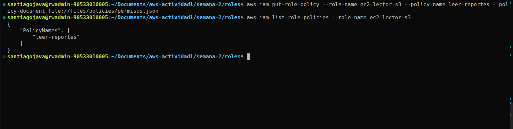

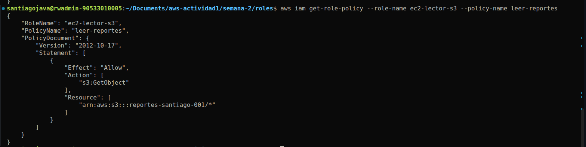

## 5. Descripción y etiqueta (pasos 14 a 16)

Las capturas muestran el comando `update-role` y la consulta de la descripción. En el paso 16, `get-role` devuelve el nombre `ec2-lector-s3`, la descripción `Rol para que EC2 lea reportes` y la etiqueta `semana=1`.


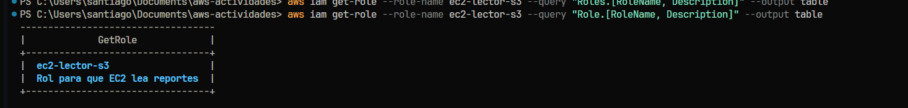

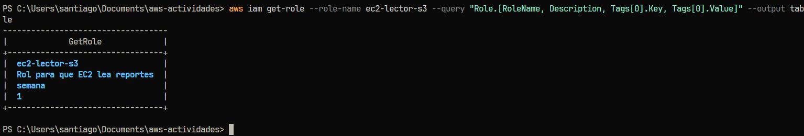

## 6. Perfil de instancia (pasos 17 a 19)

`create-instance-profile` devuelve el perfil `ec2-lector-s3` con `Roles: []`. Después de ejecutar `add-role-to-instance-profile`, la consulta del paso 19 muestra el rol `ec2-lector-s3` dentro de `Roles`. El ARN del perfil es `arn:aws:iam::221829235055:instance-profile/ec2-lector-s3`.

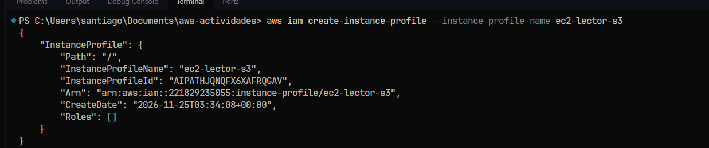

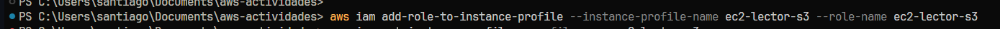

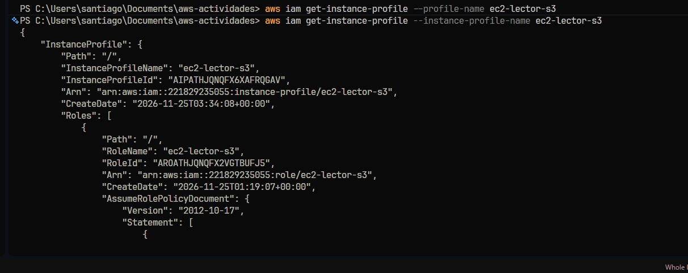

## 7. Intento de borrado (paso 20)

El comando `aws iam delete-role --role-name ec2-lector-s3` devuelve el siguiente error:

```text
aws: [ERROR]: An error occurred (DeleteConflict) when calling the DeleteRole operation: Cannot delete entity, must remove roles from instance profile first.
```

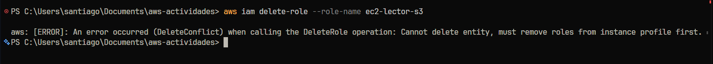

En las últimas salidas disponibles, `reporte.txt` se subió al bucket, el perfil contiene el rol y el intento de borrarlo fue rechazado. La práctica de EC2 usará esos recursos.

## Preguntas de reflexión

1. **¿Qué diferencia hay entre las políticas de confianza y de permisos?** La de confianza define quién puede asumir el rol. En este caso es EC2. La de permisos define qué puede hacer quien ya lo asumió. Con solo la de confianza, EC2 podría asumirlo, pero el rol carecería de permisos para leer S3. Si solo se tuviera la de permisos, IAM rechazaría la creación del rol porque exige una política de confianza.
2. **¿Por qué conviene usar un rol en vez de guardar una llave con `aws configure`?** La instancia recibe credenciales temporales mediante el perfil y AWS las renueva automáticamente. Una llave guardada en el servidor puede copiarse y seguir siendo válida hasta que se desactive o se elimine. Con el rol se evita guardar esa llave y, si se filtran las credenciales temporales, su validez termina al expirar.
3. **¿Puede la instancia listar el bucket o borrar `reporte.txt` con `leer-reportes`?** No puede hacer ninguna de las dos cosas con esa política. `s3:GetObject` le permite leer `reporte.txt` si ya conoce su clave. Listar requiere `s3:ListBucket` sobre el bucket, y borrar requiere `s3:DeleteObject` sobre el objeto.
4. **¿Qué falta hacer antes de borrar el rol?** El error indica que primero hay que sacar `ec2-lector-s3` del perfil de instancia. Cuando termine la práctica de EC2, también se debe quitar la política en línea `leer-reportes` antes de volver a ejecutar `delete-role`.
5. **¿Qué cambiaría si la instancia también necesitara subir archivos?** En `permisos.json` agregaría `s3:PutObject` junto a `s3:GetObject` y aplicaría la política actualizada al rol. El permiso de escritura se limitaría a los objetos del bucket, o al prefijo necesario si se conoce. EC2 ya figura como servicio autorizado en `confianza.json`.
