# Ciclo de vida de un bucket en Amazon S3

- Bucket `practica-santiago-001`
- Región `us-east-2`
- Usuario IAM `lector-s3-santiago` con el perfil `lector-s3`

## 1. Bucket y región

El listado de buckets muestra `practica-santiago-001`. En el paso 3, la consulta de ubicación devuelve `us-east-2`.

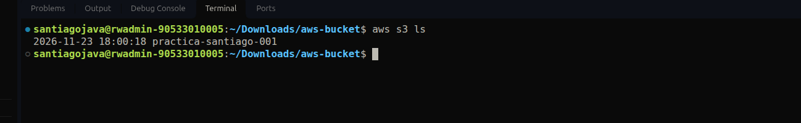

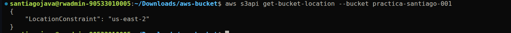

## 2. Subida de objetos

Las salidas de los pasos 5 y 6 muestran la subida de `notas.txt` con `cp` y la de `secreto.txt` y `tareas.txt` con `sync`. Para el paso 7, el [listado disponible](./capturas/07-renombrado-y-listado.png) aparece después del renombrado y muestra tres objetos. Las capturas no muestran el listado inicial con el tamaño total.

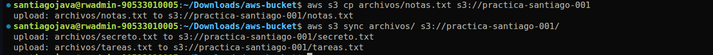

## 3. Consulta y descarga

En el paso 8, `notas.txt` se muestra directamente en la terminal y contiene una línea, `2020-05-05 cumple`. En el paso 9, el listado de `tareas.txt` muestra `15 Bytes` y la fecha `2026-11-23 19:55:48`. En el paso 10, la salida de la descarga y el listado local muestran `descargas/secreto.txt`.

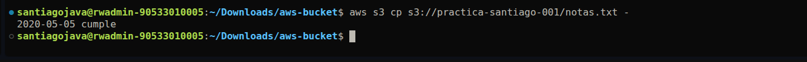

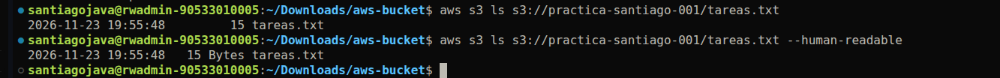

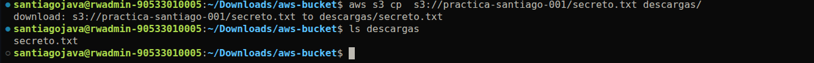

## 4. Renombrado y actualización

En el paso 11, `tareas.txt` se mueve a `pendientes.txt`. El listado de ese momento muestra `notas.txt` (18 bytes), `pendientes.txt` (15 bytes) y `secreto.txt` (11 bytes). En otra captura, una segunda sincronización vuelve a subir `notas.txt` y `tareas.txt` desde la carpeta local.

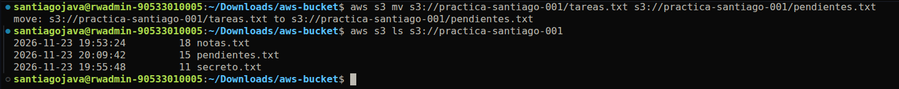

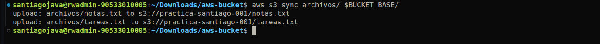

En los pasos 12 y 13, la terminal muestra la lectura de `notas.txt` antes de subirlo de nuevo y la lectura posterior desde S3. La segunda lectura muestra estas dos líneas:

```text
2020-05-05 cumple
2026-05-05 no cumple
```

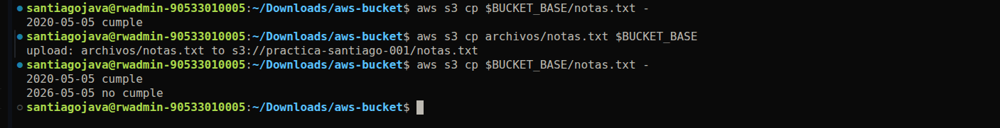

## 5. Enlace temporal

En los pasos 14 y 15 se genera un enlace firmado por 60 segundos y se abre `notas.txt` en el navegador. En el paso 16, la respuesta cambia a `AccessDenied` con el mensaje `Request has expired`.


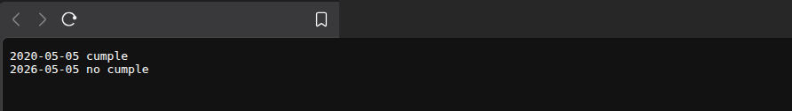

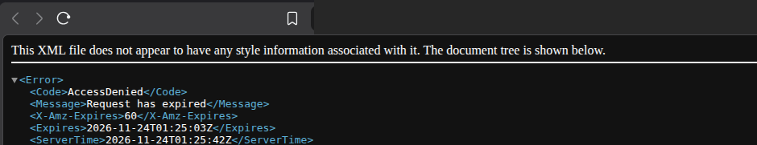

## 6. Permisos del usuario lector

Las capturas muestran la creación de `lector-s3-santiago`, la aplicación de la política en línea `s3onlyget` y el comando de configuración del perfil `lector-s3`. La política permite `s3:GetObject` sobre los objetos de `practica-santiago-001`. [Archivo de la política](./solo-lectura.json)

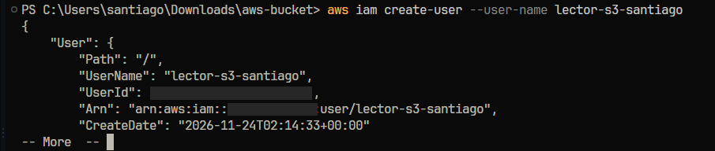

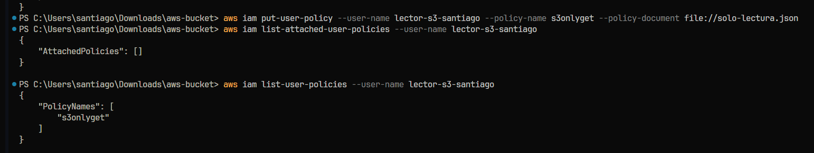

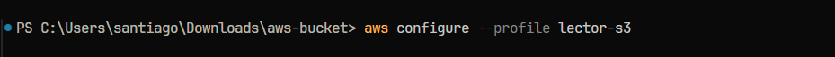

| Paso | Prueba con `lector-s3` | Resultado |
| --- | --- | --- |
| 21 | Leer `notas.txt`. | La terminal muestra las dos líneas del objeto. |
| 22 | Listar los objetos del bucket. | `AccessDenied` en `ListObjectsV2` por falta de `s3:ListBucket`. |
| 23 | Borrar `secreto.txt`. | `AccessDenied` en `DeleteObject` por falta de `s3:DeleteObject`. |

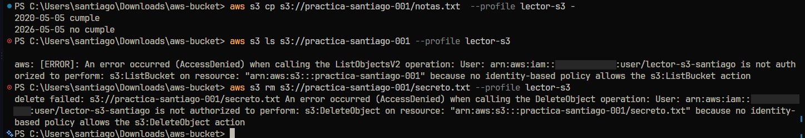

## 7. Limpieza y verificación final

Las capturas no muestran el intento de borrar el bucket con objetos del paso 24 ni el vaciado del paso 25. En la captura de limpieza aparecen los comandos para retirar la llave y la política en línea del lector, y la apertura del archivo de configuración local. La edición de los archivos del perfil queda sin confirmar en las capturas.

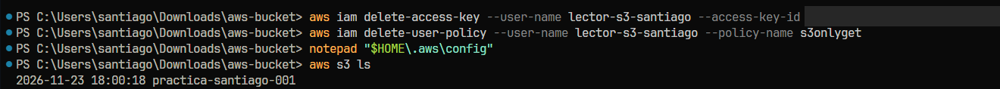

En la verificación final del paso 29, la terminal muestra `remove_bucket: practica-santiago-001`, el listado de S3 sin resultados y el listado de usuarios de IAM con `admin-santiago` como única entrada.

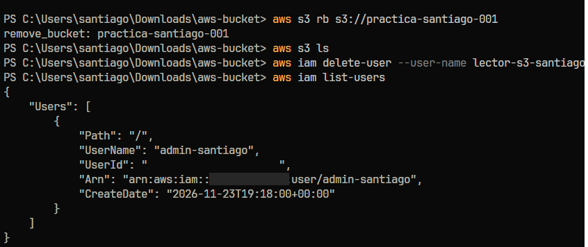

## Preguntas de reflexión

1. **¿Por qué el nombre del bucket debe ser distinto entre cuentas?** Los buckets de este tipo comparten el espacio de nombres de S3 dentro de la misma partición de AWS. Un nombre que ocupa otra cuenta tampoco está disponible para mi cuenta.
2. **¿Qué permiso faltaba para listar los objetos?** `s3:ListBucket`, que se aplica al ARN del bucket `arn:aws:s3:::practica-santiago-001`.
3. **¿Qué significa `/*` al final de `Resource`?** Abarca todas las claves de objeto dentro del bucket. Si se quita, el ARN apunta al bucket y la declaración deja de dar permiso a `s3:GetObject` sobre los objetos.
4. **¿Qué diferencia hay entre el enlace temporal y un bucket público?** El enlace firmado permite que quien lo tenga lea el objeto indicado hasta que venza, manteniendo privada la configuración del bucket. El acceso público depende de los permisos configurados y puede dar acceso anónimo a más objetos mientras esos permisos sigan vigentes.
5. **¿De quién es la responsabilidad si quedan datos de clientes en un bucket público?** Del cliente que administra la cuenta y configura los permisos de los datos. AWS se encarga de la seguridad de la infraestructura del servicio.
